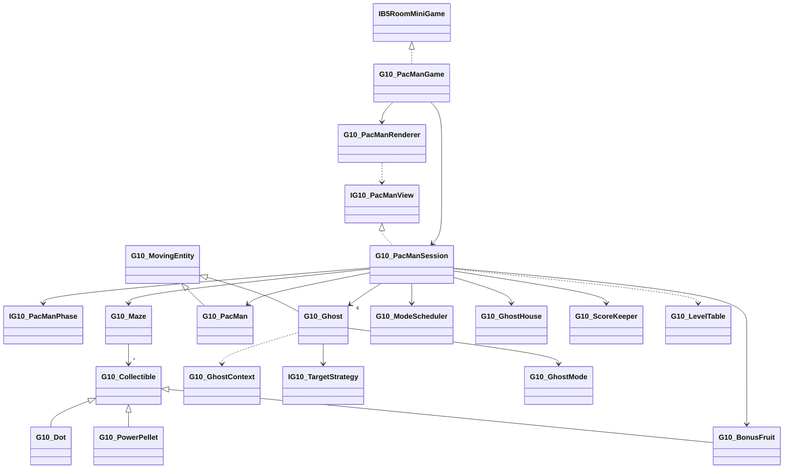

# Pac-Man für die Atari-Konsole (Retro-Kinderzimmer, Gruppe 10)

| | |
|---|---|
| **Status** | Entwurf – noch nicht mit Team / Dozent abgestimmt |
| **Autor** | Johannes Lacher |
| **Branch** | `gruppe10` |
| **Code** | `Classes/10_Gruppe/PacMan/`, `Interfaces/10_Gruppe/PacMan/` |
| **Englische Fassung** | [2026-11-19_Johannes_Lacher_PacMan_EN.md](2026-11-19_Johannes_Lacher_PacMan_EN.md) (beide Fassungen haben denselben Inhalt) |

## 1. Ziel

Ein vollständiges Pac-Man als neue Kassette für die **Atari-Konsole** im Kinderzimmer. Der Atari bietet
bisher nur „Muenzen sammeln“. Pac-Man soll sauberes objektorientiertes Design zeigen: kleine Klassen
mit je einer Aufgabe, austauschbares Verhalten über Interfaces (Strategy, State) und eine Spiellogik,
die unabhängig von WPF ist und sich einzeln testen lässt.

**Umfang (Pflicht)**

- Labyrinth mit Punkten, Kraftpillen und Tunnel; Pac-Man wird mit den Pfeiltasten oder WASD gesteuert.
- Vier Geister, jeder mit eigenem Verfolgungsverhalten (siehe 4.5), Geisterhaus, Scatter-/Chase-Phasen.
- Kraftpille → Geister werden verängstigt; gefressene Geister bringen 200/400/800/1600 Punkte.
- Leben, Extraleben bei 10.000 Punkten, Level mit steigendem Tempo, Bonusfrucht, Highscore.
- Spielphasen: READY → Spielen (mit Pause) → Sterbeanimation / Level geschafft → GAME OVER.

**Optional (Kür)**: „Cruise Elroy“-Modus für Blinky, zweites Labyrinth ab Level 3, Zwischensequenzen.

**Nicht enthalten**: Sound (das Framework hat kein Audio), Original-Sprites oder ROM-Daten.

## 2. Rahmenbedingungen

- Läuft als `IB5RoomMiniGame` im bestehenden Hub. Kein eigenes Fenster, keine eigene Hauptschleife,
  keine Framework-Änderung. Aktualisierung im **40-ms-Takt (25 Hz)** des Hubs.
- Das Framework meldet nur **KeyDown**. Das passt zu Pac-Man: Die zuletzt gedrückte Richtung bleibt
  gespeichert und wird genommen, sobald das Labyrinth es erlaubt. Keine Taste muss gehalten werden.
- Namen: Klassen `G10_…`, Interfaces `IG10_…`, Dateien `Johannes_Lacher_PacMan<Thema>.cs`. C#-Stil:
  Methoden und Enum-Werte in PascalCase (`Update()`, `G10_Direction.Up`).
- Änderungen nur in `Classes/10_Gruppe/` und `Interfaces/10_Gruppe/`.

## 3. Darstellung

- Kacheln 8 × 8 px, Labyrinth 28 × 31 Kacheln = **224 × 248 px**.
- Der Atari-Bildschirm ist ein 4:3-Fernseher. Logische Auflösung **336 × 252** (genau 4:3): Labyrinth
  links, rechts eine 112 px breite HUD-Spalte (SCORE, HIGH SCORE, LEVEL, Leben, Früchte).
- Figuren sind 16 × 16 px große Pixel-Sprites, von uns selbst als Pixelmuster im Code gezeichnet.
- Das Labyrinth wird **einmal** pro Level gezeichnet und zwischengespeichert. Pro Frame werden nur
  Punkte, Figuren und HUD gezeichnet.

**Nötige Hub-Änderung (Entscheidung E1):** Der Painter skaliert derzeit nur bei
`B5RoomTowerDefenseGame` auf ganzzahlige Faktoren (Typprüfung in `B5_RoomPaint.cs`, `SizeGameFrame`).
Außerdem setzt er `Canvas.Tag` bei jedem anderen Spiel zurück; darin speichert Tower Defense seine
Pixel-Oberfläche. Vorschlag:

1. Neues Marker-Interface `IB5RoomPixelGame : IB5RoomMiniGame` in `B5_RoomInterfaces.cs`.
2. Der Painter prüft auf dieses Interface statt auf die konkrete Tower-Defense-Klasse. Tower Defense
   und Pac-Man implementieren es.
3. `TowerDefensePixelSurface` wird zu einer allgemeinen `B5PixelSurface` umbenannt, die beide Spiele
   nutzen.

Das betrifft Dateien des Tower-Defense-Autors und muss vorher mit ihm abgestimmt werden. Ausweichlösung
ohne Hub-Änderung: Pac-Man zeichnet Vektorgrafik (wie Void Courier); das Bild ist dann weich statt
pixelscharf.

## 4. Architektur

### 4.1 Schichten

Drei Schichten. Abhängigkeiten zeigen nur nach unten:

```
 Hub (B5RoomRegistry, Painter)          — kennt nur IB5RoomMiniGame
   │
 Adapter:   G10_PacManGame              — Tasten → G10_PacManInput, besitzt Session + Renderer
   │
 Ansicht:   G10_PacManRenderer          — liest nur IG10_PacManView (nur lesend)
   │
 Modell:    G10_PacManSession & Co.     — ohne WPF, ohne Tasten, ohne Zeichnen; deterministisch, testbar
```

### 4.2 Entwurfsentscheidungen

| Entscheidung | Grund |
|---|---|
| **Spiellogik und Zeichnen sind getrennt.** Modellklassen haben keine `Draw()`-Methode. Der Renderer liest den Spielzustand über das nur lesende Interface `IG10_PacManView` | Das Modell hängt nicht von WPF ab und lässt sich ohne Fenster testen. Der Renderer kann das Spiel nicht verändern |
| **Pac-Man kennt keine Tasten.** Der Adapter `G10_PacManGame` übersetzt Tasten in `G10_PacManInput`; die Session ruft `G10_PacMan.RequestDirection(direction)` auf | Eingabe ist Sache des Hubs/Frameworks, nicht der Spielfigur. Tests können Pac-Man ohne Tasten steuern |
| **Punkte und Kraftpillen gehören zum Labyrinth-Raster** (`G10_Collectible[,]` in `G10_Maze`), nicht als Objekte in eine Liste | 244 Punkte müssen nicht jeden Frame aktualisiert oder auf Kollision geprüft werden. Nur die Kachel, die Pac-Man betritt, wird nachgeschlagen |
| **Die Bonusfrucht ist ein freies Objekt** mit eigener Kachel und Lebensdauer | Sie erscheint und verschwindet unabhängig vom Labyrinth |
| **Einsammeln liefert ein Ergebnis** (`G10_CollectResult`: Punkte und Effekt). Das Sammelobjekt verändert das Spiel nicht selbst; die Session reagiert (Punkte, Geister verängstigen, Zähler im Geisterhaus, Frucht) | Sammelobjekte brauchen keinen Zugriff aufs ganze Spiel. Alle Folgen stehen an einer Stelle |
| **Der Geistermodus entscheidet, was eine Kollision bedeutet:** `G10_GhostMode.OnCollision(ghost, pacMan)` liefert ein `G10_CollisionOutcome` (`None`, `PacManDies`, `GhostEaten`) | Kein `if (mode == Frightened)` in der Session. Ein neuer Modus bringt sein eigenes Kollisionsverhalten mit |
| **Zielstrategien bekommen ein Kontextobjekt** `G10_GhostContext` (Pac-Man, Blinky, Labyrinth, …) | Flank (Inky) braucht Blinkys Position. Alle Strategien haben dieselbe Signatur |
| **Geister kehren in den gerade aktiven Modus zurück** (Scatter oder Chase aus `G10_ModeScheduler`), nicht in einen festen Modus | Entspricht dem Original und hält alle Geister im Takt des gemeinsamen Zeitplans |
| **Keine gemeinsame `GameObject`-Basis mit `Update()`** | Die Reihenfolge innerhalb eines Ticks ist wichtig (siehe 4.6). Die Session ruft die Teile in fester Reihenfolge auf, statt eine gemischte Liste zu aktualisieren |

### 4.3 Klassenübersicht



### 4.4 Modell (ohne WPF-Abhängigkeit)

**Raster und Labyrinth**

| Klasse / Typ | Aufgabe |
|---|---|
| `G10_Direction` + `G10_DirectionExtensions` | `Up`, `Left`, `Down`, `Right`, `None`; Versatz, `Opposite()` |
| `G10_Tile` (struct) | Kachelkoordinate, `Neighbour(direction)`, Abstand |
| `G10_TileKind` | `Wall`, `Floor`, `GhostDoor`, `Tunnel` |
| `G10_MazeLayout` | Labyrinth als Text-Array (`#` Wand, `.` Punkt, `o` Kraftpille, `-` Tür, …) plus Startpositionen und Scatter-Ecken. Neue Labyrinthe = neue Daten, kein neuer Code |
| `G10_Maze` | Wird aus einem Layout erzeugt. Hält die Kachelarten und ein `G10_Collectible[,]`-Raster. `IsWalkable(tile, entity)` (Tür nur für Geister im passenden Modus), `Collect(tile)`, `DotsLeft`, Tunnel-Umbruch, `IsTunnel(tile)` |

**Sammelobjekte**

| Klasse / Typ | Aufgabe |
|---|---|
| `G10_Collectible` (abstrakt) | `Points`; `abstract G10_CollectResult Collect()` |
| `G10_Dot` | 10 Punkte, kein Effekt; liegt im Labyrinth-Raster |
| `G10_PowerPellet` | 50 Punkte, Effekt `FrightenGhosts`; liegt im Labyrinth-Raster |
| `G10_BonusFruit` | Freies Objekt: Kachel, Punkte je nach Level, Lebensdauer (ca. 9,5 s). Erscheint nach 70 und 170 gefressenen Punkten |
| `G10_CollectResult` (struct) | `Points` und `G10_CollectEffect` (`None`, `FrightenGhosts`, `Fruit`). Die Session reagiert darauf |

**Bewegliche Figuren**

| Klasse / Typ | Aufgabe |
|---|---|
| `G10_MovingEntity` (abstrakt) | Position in Subpixeln, Richtung, Tempo. `Move(maze)` (Template Method) läuft von Kachelmitte zu Kachelmitte, stoppt an Wänden, springt durch den Tunnel und ruft an jeder Mitte `ChooseDirectionAtCenter()` auf |
| `G10_PacMan : G10_MovingEntity` | `RequestDirection(direction)` merkt sich die nächste Richtung; biegt ab, sobald es geht; bleibt an Wänden stehen. Keine Tastenverarbeitung |
| `G10_Ghost : G10_MovingEntity` | Hat eine `IG10_TargetStrategy`, einen `G10_GhostMode` und eine Scatter-Ecke. An jeder Kreuzung wählt er die Nachbarkachel, die der Zielkachel am nächsten ist, kehrt nie um und entscheidet bei Gleichstand in der Reihenfolge Hoch > Links > Runter > Rechts. `Frighten()`, `ReverseDirection()` |
| `G10_GhostContext` | Alles, was ein Geist für einen Tick braucht: Pac-Man, Blinky, Labyrinth, der gerade aktive Modus aus `G10_ModeScheduler`, Zufallsquelle |

**Geisterverhalten (siehe 4.5), Spielablauf und Daten**

| Klasse / Typ | Aufgabe |
|---|---|
| `IG10_TargetStrategy` + `G10_DirectChase`, `G10_Ambush`, `G10_Flank`, `G10_Shy` | `TargetTile(ghost, context)`; Ziel im Chase-Modus |
| `G10_GhostMode` (abstrakt) + sechs Modi | Verhalten je Modus: Tempo, Zielkachel, Tür erlaubt, `OnCollision(ghost, pacMan)` |
| `G10_ModeScheduler` | Scatter-/Chase-Zeitplan je Level; pausiert während Verängstigung; Angst-Timer inklusive Blinken in den letzten 2 s; meldet Moduswechsel |
| `G10_GhostHouse` | Freilass-Reihenfolge und Punktezähler (Pinky sofort, Inky nach 30, Clyde nach 60 Punkten); lässt den nächsten Geist frei, wenn Pac-Man 4 s lang nichts frisst |
| `G10_LevelSettings` / `G10_LevelTable` | Daten je Level: Tempo, Angstdauer, Modus-Zeiten, Frucht. Kein `if (level == …)` in der Logik |
| `G10_ScoreKeeper` | Punkte, Geister-Kombo 200/400/800/1600 (durch die nächste Kraftpille zurückgesetzt), Extraleben bei 10.000, Highscore (über das vorhandene `B5RoomHighscores`) |
| `G10_PacManSession` | Steuert einen Tick, reagiert auf `G10_CollectResult` und `G10_CollisionOutcome`, besitzt das Spielphasen-Objekt, implementiert `IG10_PacManView`. Delegiert nur; hält Punkte und Leben nicht selbst |
| `IG10_PacManPhase` + Phasen | `Ready`, `Playing`, `Paused`, `Dying`, `LevelCleared`, `GameOver`. Jede Phase bestimmt ihr eigenes `Update` und die nächste Phase. Kein Startmenü: Das übernimmt schon das Gerätemenü des Hubs, und `Ready` zeigt den Startbildschirm |
| `G10_PointsPopup` | Punkte-Einblendungen (gefressener Geist, gefressene Frucht). Die Session hält die sichtbaren in einer Liste der nur lesenden Ansicht und entfernt sie nach ihrer Zeit; der Renderer liest nur die Liste und kennt das Modell nicht |

**Position und Tempo:** als ganze Zahlen in Subpixeln gespeichert (1 px = 16 Einheiten), nicht als
`float`. Das Spiel ist dadurch genau reproduzierbar, und ein Test mit festem Zufalls-Seed liefert
immer dasselbe Ergebnis. 100 % Tempo ≈ 75,75 px/s ≈ 3 px pro Tick. Die Level-Tabelle speichert
Prozentwerte (Pac-Man 80 % in Level 1, Geister 75 %, Tunnel 40 %, verängstigt 50 %).

**Bewegung bei 25 Hz:** Ein Tick kann über mehr als eine Kachelmitte hinausgehen. `Move()` bewegt
deshalb in Schritten bis zur nächsten Mitte, entscheidet dort und läuft mit der Reststrecke weiter.
Keine Kreuzung wird übersprungen.

**Kollision:** Pac-Man und ein Geist kollidieren, wenn sie nach der Bewegung auf derselben Kachel
stehen **oder** im selben Tick ihre Kacheln getauscht haben. Sonst könnten sie bei 3 px pro Tick
durcheinander hindurchlaufen.

### 4.5 Geister: Strategy + State

Zielstrategien (Strategy, je eine Klasse, nach dem Verhalten benannt):

| Strategie | Genutzt von | Ziel im Chase-Modus |
|---|---|---|
| `G10_DirectChase` | Blinky (rot) | Pac-Mans Kachel |
| `G10_Ambush` | Pinky (rosa) | 4 Kacheln vor Pac-Man |
| `G10_Flank` | Inky (cyan) | Punkt 2 Kacheln vor Pac-Man, Vektor von Blinky dorthin verdoppelt (Blinky aus dem Kontext) |
| `G10_Shy` | Clyde (orange) | Pac-Man, wenn mehr als 8 Kacheln entfernt, sonst seine Scatter-Ecke |

Geistermodi (State-Pattern, je eine Klasse):

| Modus | Ziel / Bewegung | `OnCollision(ghost, pacMan)` | Nächster Modus |
|---|---|---|---|
| `G10_InHouseMode` | Wippt im Haus auf und ab | `None` | `LeavingHouse`, wenn `G10_GhostHouse` ihn freilässt |
| `G10_LeavingHouseMode` | Durch die Tür auf die Kachel darüber | `None` | Gerade aktiver Modus (Scatter oder Chase) |
| `G10_ScatterMode` | Eigene Scatter-Ecke | `PacManDies` | Chase, wenn der Zeitplan wechselt (kehrt um) |
| `G10_ChaseMode` | Kachel aus der Zielstrategie | `PacManDies` | Scatter, wenn der Zeitplan wechselt (kehrt um) |
| `G10_FrightenedMode` | Zufällige Richtung an Kreuzungen, 50 % Tempo, blinkt vor dem Ende | Setzt den Geist auf `Eaten`, liefert `GhostEaten` | Gerade aktiver Modus, wenn die Zeit abgelaufen ist |
| `G10_EatenMode` | Nur die Augen, schnell, zum Haus; darf durch die Tür | `None` | `LeavingHouse` |

Der Geist muss nie fragen, in welchem Modus er ist. Er überlässt das seinem Modus. Der „gerade aktive
Modus“ kommt immer über den Kontext aus `G10_ModeScheduler`, sodass alle Geister im Takt bleiben.

### 4.6 Reihenfolge eines Ticks in der Phase `Playing`

1. Eingabe an Pac-Man (`RequestDirection`).
2. Pac-Man bewegen; `maze.Collect(tile)` → Session wertet `G10_CollectResult` aus: Punkte, bei
   `FrightenGhosts` alle Geister verängstigen und Timer starten, Punkt für das Geisterhaus zählen.
3. `G10_ModeScheduler` und Angst-Timer weiterzählen; bei einem Moduswechsel wechseln Geister in
   Scatter/Chase und kehren um.
4. `G10_GhostHouse` lässt fällige Geister frei.
5. Geister bewegen (`G10_GhostContext` für Ziel und Modus).
6. Kollisionen prüfen → `ghost.Mode.OnCollision(ghost, pacMan)` → Session wertet
   `G10_CollisionOutcome` aus: `GhostEaten` → Kombo-Punkte; `PacManDies` → Phase `Dying`.
7. Bonusfrucht erscheint, wird gefressen (wieder `G10_CollectResult`) oder läuft ab.
8. Keine Punkte mehr → `LevelCleared`.

### 4.7 Adapter und Ansicht

- `G10_PacManGame : IB5RoomMiniGame` (später zusätzlich `IB5RoomPixelGame`):
  `Title = "Pac-Man"`, `Width = 336`, `Height = 252`. Übersetzt Tasten mit dem vorhandenen Helfer
  `B5RoomKeys` in `G10_PacManInput` (Richtung, Bestätigen). Enter/Z: Start, Pause, neues Spiel nach
  GAME OVER. Esc/X bleibt wie bisher beim Hub (zurück zur Geräteansicht). Das ist die einzige Klasse,
  die Tasten kennt.
- `G10_PacManRenderer` bekommt nur `IG10_PacManView` und kann das Spiel nicht verändern.
  Punkte-Einblendungen kommen aus `IG10_PacManView.Popups`.
  `G10_PacManSprites` enthält die Pixelmuster: Pac-Man mit 3 Mundbildern je Richtung,
  Sterbeanimation, Geisterkörper mit 2 Bildern, Augen je Richtung, verängstigt blau und weiß blinkend.

### 4.8 Registrierung

Eine Zeile in `B5_RoomCore.cs`, im Atari-Eintrag von `B5RoomRegistry`:

```csharp
new B5RoomGameEntry("Pac-Man", Color.FromRgb(240, 200, 40), () => new G10_PacManGame())
```

## 5. Dateien

| Datei | Inhalt |
|---|---|
| `Interfaces/10_Gruppe/PacMan/Johannes_Lacher_I_PacMan.cs` | `IG10_PacManView`, `IG10_TargetStrategy`, `IG10_PacManPhase` |
| `PacMan/Johannes_Lacher_PacManGame.cs` | Adapter `G10_PacManGame`, `G10_PacManInput` |
| `PacMan/Johannes_Lacher_PacManGrid.cs` | `G10_Direction`, `G10_Tile`, `G10_TileKind` |
| `PacMan/Johannes_Lacher_PacManMaze.cs` | `G10_Maze`, `G10_MazeLayout`, Layout-Daten |
| `PacMan/Johannes_Lacher_PacManCollectibles.cs` | `G10_Collectible`, `G10_Dot`, `G10_PowerPellet`, `G10_BonusFruit`, `G10_CollectResult` |
| `PacMan/Johannes_Lacher_PacManEntities.cs` | `G10_MovingEntity`, `G10_PacMan` |
| `PacMan/Johannes_Lacher_PacManGhosts.cs` | `G10_Ghost`, `G10_GhostContext`, `G10_GhostHouse` |
| `PacMan/Johannes_Lacher_PacManTargetStrategies.cs` | `G10_DirectChase`, `G10_Ambush`, `G10_Flank`, `G10_Shy` |
| `PacMan/Johannes_Lacher_PacManGhostModes.cs` | `G10_GhostMode`, die sechs Modi, `G10_CollisionOutcome` |
| `PacMan/Johannes_Lacher_PacManModes.cs` | `G10_ModeScheduler` |
| `PacMan/Johannes_Lacher_PacManLevels.cs` | `G10_LevelSettings`, `G10_LevelTable` |
| `PacMan/Johannes_Lacher_PacManScoring.cs` | `G10_ScoreKeeper` |
| `PacMan/Johannes_Lacher_PacManSession.cs` | `G10_PacManSession`, Spielphasen |
| `PacMan/Johannes_Lacher_PacManRenderer.cs` | `G10_PacManRenderer`, `G10_PixelBuffer`, `G10_MazeBackground`, `G10_PacManHud` |
| `PacMan/Johannes_Lacher_PacManSprites.cs` | `G10_Sprite`, `G10_PacManSprites`, `G10_PixelFont` |
| `PacMan/README.md` | Kurzbeschreibung, Steuerung, Klassenübersicht |

`PacMan/` steht für `Classes/10_Gruppe/PacMan/`. Grober Richtwert: keine Klasse über ca. 250 Zeilen;
die Session delegiert nur.

## 6. Schritte

Jeder Schritt baut fehlerfrei, ist spielbar und ein eigener Commit (`G10: …`).

| # | Schritt | Ergebnis |
|---|---|---|
| 0 | E1 (Pixel-Spiel im Hub) mit dem Team abstimmen und umsetzen | Tower Defense unverändert, Pac-Man kann pixelscharf zeichnen |
| 1 | Raster, Labyrinth mit Sammelobjekten, Pac-Man-Bewegung, Adapter, einfacher Renderer, Registrierung am Atari | Pac-Man frisst Punkte, Tunnel funktioniert |
| 2 | Geist-Grundlage, Blinky mit `DirectChase`, Modi Scatter/Chase, Kollision über `OnCollision`, Leben, Phasen Ready/Dying/GameOver | Erste spielbare Runde |
| 3 | `Ambush`, `Flank`, `Shy`, Geisterhaus mit InHouse/LeavingHouse/Eaten, Modus-Zeitplan, Verängstigung, Geister-Kombo | Vollständige Geisterlogik |
| 4 | Level-Tabelle, Level geschafft, Frucht, Extraleben, Highscore, Pause | Vollständiges Spiel |
| 5 | Sprites und Animationen, HUD, README, Konzept (F7) und diesen Plan auf „Stand“ bringen | Fertig |
| 6 (optional) | Cruise Elroy, zweites Labyrinth | Kür |

## 7. Tests

Wie vereinbart: temporäre Testprogramme im Scratchpad gegen die echten Klassen, **nicht committet**.
Ergebnisse kommen als „Stand (Datum)“ in diesen Plan.

- Labyrinth: Das Layout hat genau die erwartete Anzahl Punkte und Kraftpillen; keine begehbare Kachel
  ist abgeschnitten; die Tür ist nur für Geister in `LeavingHouse`/`Eaten` begehbar.
- Sammelobjekte: `Collect()` liefert die richtigen Punkte und den richtigen Effekt; eine eingesammelte
  Kachel ist danach leer; die Frucht verschwindet nach ihrer Lebensdauer.
- Bewegung: Pac-Man läuft nie in Wände; eine gewünschte Abbiegung wird an der nächsten Kreuzung
  genommen; der Tunnel funktioniert in beide Richtungen; bei Höchsttempo wird keine Kachelmitte
  übersprungen.
- Zielwahl: feste Positionen → erwartete Zielkachel je Strategie (inklusive des 8-Kachel-Radius von
  `Shy` und des Vektors von `Flank` über Blinky aus dem Kontext).
- Modi: Zeitplan für Level 1; Geister kehren bei Moduswechsel um; Angstdauer je Level;
  `OnCollision` liefert in jedem Modus das erwartete Ergebnis; ein gefressener Geist kehrt in den
  Modus zurück, der in dem Moment aktiv ist (einmal während Scatter, einmal während Chase getestet);
  Kombo 200→1600, durch die nächste Kraftpille zurückgesetzt.
- Kollision: kein Durchlaufen bei getauschten Kacheln.
- Determinismus: gleicher Seed und gleiche Eingabefolge → gleiche Punktzahl nach N Ticks.
- Hub: `G10_PacManGame` mit dem echten `B5RoomPainter`, Screenshot per `RenderTargetBitmap`.
- **Manuell im laufenden Programm:** Spielgefühl bei 25 Hz, Lesbarkeit der Sprites, Esc zurück zur
  Geräteansicht.

## 8. Offene Entscheidungen

| # | Frage | Vorschlag |
|---|---|---|
| E1 | Hub-Änderung für pixelscharfe Spiele (Abschnitt 3) | Marker-Interface und allgemeine Pixel-Oberfläche, abgestimmt mit dem Tower-Defense-Autor |
| E2 | Klassisches Labyrinth und Name „Pac-Man“ übernehmen oder eigenes Labyrinth / eigener Name? Void Courier hat das Original bewusst nicht kopiert | Regeln und Geister-KI wie im Original (Spielmechanik), aber eigene Sprites. Labyrinth und Name mit dem Dozenten klären |
| E3 | Zählt Pac-Man zur Komplexität des Gruppenspiels? | Bei der nächsten Konzeptvorstellung ansprechen; im Konzept als neues Atari-Spiel nennen |
| E4 | SCRUM: `Classes/10_Gruppe/Scrum/` existiert noch nicht | Schritte 0–5 als User Stories ins Backlog, sobald es angelegt ist |

## 9. Stand (2026-11-19): Schritte 1–5 umgesetzt

- Wie geplant umgesetzt: Modell, Adapter, Renderer, Sprites, Registrierung am Atari („Pac-Man“).
  Das Projekt baut ohne Fehler und Warnungen. Sprites und Renderer haben zwei Sub-Agenten parallel
  gegen feste Verträge geschrieben; das Modell wurde direkt geschrieben.
- **E1 ohne Hub-Änderung:** Der Renderer zeichnet in eine eigene `WriteableBitmap` (336 × 252) mit
  Nearest-Neighbor-Skalierung. Die Pixel bleiben scharf, ohne Hub oder Tower Defense anzufassen. Die
  Hub-Änderung aus Abschnitt 3 brächte nur noch ganzzahlige Skalierung (keine ungleich breiten Pixel)
  und ist jetzt optional.
- Abweichungen vom Plan: `G10_PacManEvents` wurde durch die Popup-Liste in der Ansicht ersetzt (kein
  Event-Abo, das ein neues Spiel überleben muss). Die Sprites haben eine eigene Datei. Den Highscore
  speichert der Adapter bei GAME OVER, damit das Modell keine Dateien schreibt.
- Tests (temporäres Testprogramm, nicht committet): **70 von 70 bestanden**. Abgedeckt: Anzahl Punkte
  (240 + 4) und Erreichbarkeit, Tür nur für Geister, Sammelergebnisse, Stopp an der Wand, vorgemerkte
  Abbiegung, sofortiges Umkehren, Tunnel in beide Richtungen, Zufallsläufe über 20.000 Ticks für
  Pac-Man und einen Geist mit 250 % Tempo (nie in einer Wand, nie neben der Gangmitte), alle vier
  Zielstrategien, Modus-Zeitplan Level 1 inklusive Pause während Verängstigung, `OnCollision` in allen
  sechs Modi, gefressener Geist kehrt in den gerade aktiven Modus zurück (Scatter und Chase), Kombo und
  Extraleben, Pause, alle Geister verlassen das Haus, Level geschafft → Level 2 neu befüllt,
  Determinismus, Registrierung am Atari und ein Dauertest über 240.000 Ticks (190 Spiele) ohne
  Durchlaufen zwischen Pac-Man und einem gefährlichen Geist. Screenshots von READY, Spielen und Pause
  visuell geprüft.
- **Noch von Hand im laufenden Programm zu prüfen:** Spielgefühl bei 25 Hz, Lesbarkeit der Sprites in
  echter Fenstergröße, Esc zurück zur Geräteansicht und Weiterspielen, Highscore nach GAME OVER
  gespeichert.
- Offen: Schritt 6 (optional), E2–E4, Konzept (F7) nachtragen.
