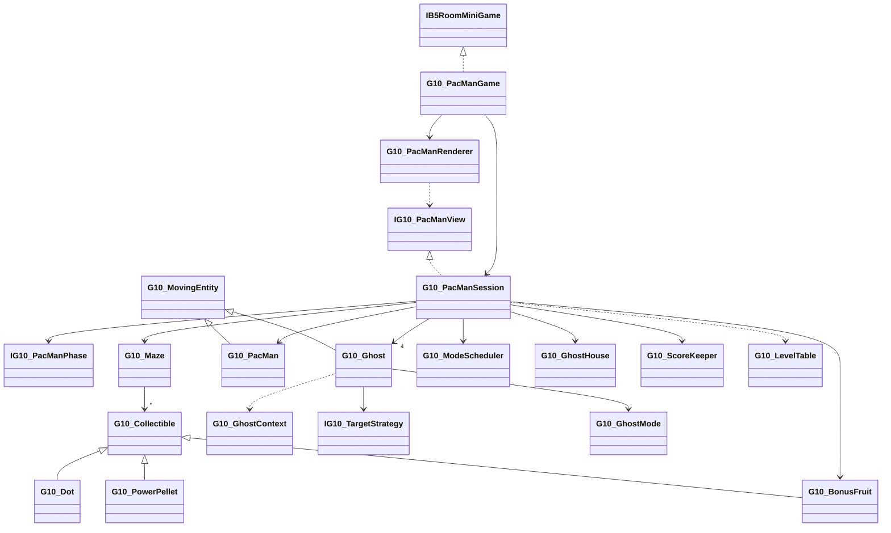

# Pac-Man for the Atari console (Retro Kinderzimmer, group 10)

| | |
|---|---|
| **Status** | Draft – not yet discussed with the team / lecturer |
| **Author** | Johannes Lacher |
| **Branch** | `gruppe10` |
| **Code** | `Classes/10_Gruppe/PacMan/`, `Interfaces/10_Gruppe/PacMan/` |
| **German version** | [2026-11-19_Johannes_Lacher_PacMan.md](2026-11-19_Johannes_Lacher_PacMan.md) (both versions have the same content) |

## 1. Goal

A complete Pac-Man as a new cartridge for the **Atari console** in the Kinderzimmer. The Atari currently
offers only "Muenzen sammeln". Pac-Man should demonstrate clean object-oriented design: small classes
with one responsibility each, replaceable behaviour through interfaces (Strategy, State), and game
logic that is independent of WPF and can be tested on its own.

**Scope (must)**

- Maze with dots, power pellets and a wrap-around tunnel; Pac-Man is steered with the arrow keys or WASD.
- Four ghosts, each with its own chase behaviour (see 4.4), a ghost house, and scatter/chase phases.
- Power pellet → ghosts become frightened; eating ghosts scores 200/400/800/1600 points.
- Lives, extra life at 10,000 points, levels with rising speed, bonus fruit, highscore.
- Game phases: READY → playing (with pause) → death animation / level complete → GAME OVER.

**Optional (stretch)**: Blinky's "Cruise Elroy" mode, a second maze layout from level 3 onwards,
intermissions.

**Sound effects** (added later, see section 10): start tune, chomping, siren, frightened ghosts,
eyes returning home, eaten ghost, fruit, extra life, death. All generated in code.

**Not included**: original sprites, sounds or ROM data.

## 2. Constraints

- Runs as `IB5RoomMiniGame` inside the existing hub. No dedicated window or main loop, no framework
  change. Updates come in the hub's **40 ms tick (25 Hz)**.
- The framework only reports **KeyDown**. This suits Pac-Man: the last direction pressed stays stored
  and is taken as soon as the maze allows it. No key needs to be held down.
- Names: classes `G10_…`, interfaces `IG10_…`, files `Johannes_Lacher_PacMan<Topic>.cs`. C# style:
  methods and enum values in PascalCase (`Update()`, `G10_Direction.Up`).
- Changes only inside `Classes/10_Gruppe/` and `Interfaces/10_Gruppe/`.

## 3. Display

- Tiles of 8 × 8 px, maze 28 × 31 tiles = **224 × 248 px**.
- The Atari screen is a 4:3 TV. Logical resolution is **336 × 252** (exactly 4:3): maze on the left, an
  HUD column 112 px wide on the right (SCORE, HIGH SCORE, LEVEL, lives, fruits).
- Characters are 16 × 16 px pixel sprites, drawn by us as pixel patterns in code.
- The maze is rendered **once** per level and cached. Each frame draws only dots, characters and the
  HUD.

**Hub change required (decision D1):** The painter currently scales to whole-number factors only for
`B5RoomTowerDefenseGame` (type check in `B5_RoomPaint.cs`, `SizeGameFrame`). It also clears
`Canvas.Tag` for every other game, which Tower Defense uses to cache its pixel surface. Suggestion:

1. A new marker interface `IB5RoomPixelGame : IB5RoomMiniGame` in `B5_RoomInterfaces.cs`.
2. The painter checks for this interface instead of the concrete Tower Defense class. Tower Defense
   and Pac-Man implement it.
3. `TowerDefensePixelSurface` is renamed to a general `B5PixelSurface` that both games use.

This touches files written by the Tower Defense author and must be agreed with them first. Fallback
without a hub change: Pac-Man draws vector graphics (like Void Courier), so it looks soft rather than
pixel-sharp.

## 4. Architecture

### 4.1 Layers

Three layers. Dependencies only go downwards:

```
 Hub (B5RoomRegistry, Painter)          — knows only IB5RoomMiniGame
   │
 Adapter:   G10_PacManGame              — keys → G10_PacManInput, owns session + renderer
   │
 View:      G10_PacManRenderer          — reads only IG10_PacManView (read-only)
   │
 Model:     G10_PacManSession & co.     — no WPF, no keys, no drawing; deterministic, testable
```

### 4.2 Design decisions

| Decision | Reason |
|---|---|
| **Game logic and drawing are separate.** Model classes have no `Draw()` method. The renderer reads the game state through the read-only interface `IG10_PacManView` | The model does not depend on WPF and can be tested without a window. The renderer cannot change the game |
| **Pac-Man does not know about keys.** The adapter `G10_PacManGame` turns keys into `G10_PacManInput`; the session calls `G10_PacMan.RequestDirection(direction)` | Input is a matter of the hub/framework, not of the game figure. Tests can control Pac-Man without keys |
| **Dots and power pellets are part of the maze grid** (`G10_Collectible[,]` in `G10_Maze`), not objects in a list | 244 dots do not have to be updated or checked for collisions every frame. Only the tile Pac-Man enters is looked up |
| **Bonus fruit is a free object** with its own tile and lifetime | It appears and disappears independently of the maze |
| **Collecting returns a result** (`G10_CollectResult`: points and effect). The collectible does not change the game itself; the session reacts (score, frighten ghosts, ghost house counter, fruit) | Collectibles do not need access to the whole game. All consequences are visible in one place |
| **The ghost mode decides what a collision means:** `G10_GhostMode.OnCollision(ghost, pacMan)` returns a `G10_CollisionOutcome` (`None`, `PacManDies`, `GhostEaten`) | No `if (mode == Frightened)` in the session. A new mode brings its own collision behaviour |
| **Target strategies get a context object** `G10_GhostContext` (Pac-Man, Blinky, maze, …) | Flank (Inky) needs Blinky's position. All strategies have the same signature |
| **Ghosts return to the mode that is currently active** (scatter or chase from `G10_ModeScheduler`), not to a fixed mode | Matches the original and keeps all ghosts in step with the global timetable |
| **No common `GameObject` base with `Update()`** | The order within a tick matters (see 4.6). The session calls the parts in a fixed order instead of updating a mixed list |

### 4.3 Overview of classes



### 4.4 Model (no WPF dependency)

**Grid and maze**

| Class / type | Responsibility |
|---|---|
| `G10_Direction` + `G10_DirectionExtensions` | `Up`, `Left`, `Down`, `Right`, `None`; offset, `Opposite()` |
| `G10_Tile` (struct) | Tile coordinate, `Neighbour(direction)`, distance |
| `G10_TileKind` | `Wall`, `Floor`, `GhostDoor`, `Tunnel` |
| `G10_MazeLayout` | Maze as a text array (`#` wall, `.` dot, `o` power pellet, `-` door, …) plus start positions and scatter corners. New layouts = new data, no new code |
| `G10_Maze` | Built from a layout. Holds the tile kinds and a `G10_Collectible[,]` grid. `IsWalkable(tile, entity)` (the door only for ghosts in the matching mode), `Collect(tile)`, `DotsLeft`, tunnel wrap, `IsTunnel(tile)` |

**Collectibles**

| Class / type | Responsibility |
|---|---|
| `G10_Collectible` (abstract) | `Points`; `abstract G10_CollectResult Collect()` |
| `G10_Dot` | 10 points, no effect; stored in the maze grid |
| `G10_PowerPellet` | 50 points, effect `FrightenGhosts`; stored in the maze grid |
| `G10_BonusFruit` | Free object: tile, points depending on the level, lifetime (about 9.5 s). Appears after 70 and 170 dots eaten |
| `G10_CollectResult` (struct) | `Points` and `G10_CollectEffect` (`None`, `FrightenGhosts`, `Fruit`). The session reacts to it |

**Moving entities**

| Class / type | Responsibility |
|---|---|
| `G10_MovingEntity` (abstract) | Position in sub-pixels, direction, speed. `Move(maze)` (Template Method) walks from tile centre to tile centre, stops at walls, wraps through the tunnel and calls `ChooseDirectionAtCenter()` at each centre |
| `G10_PacMan : G10_MovingEntity` | `RequestDirection(direction)` stores the next direction; turns as soon as possible; stops at walls. No key handling |
| `G10_Ghost : G10_MovingEntity` | Has a `IG10_TargetStrategy`, a `G10_GhostMode` and a scatter corner. At each junction it picks the neighbour tile closest to the target tile, never reverses, and breaks ties in the order Up > Left > Down > Right. `Frighten()`, `ReverseDirection()` |
| `G10_GhostContext` | Everything a ghost needs for one tick: Pac-Man, Blinky, maze, the currently active mode from `G10_ModeScheduler`, random source |

**Ghost behaviour (see 4.5), game flow and data**

| Class / type | Responsibility |
|---|---|
| `IG10_TargetStrategy` + `G10_DirectChase`, `G10_Ambush`, `G10_Flank`, `G10_Shy` | `TargetTile(ghost, context)`; chase target in chase mode |
| `G10_GhostMode` (abstract) + six modes | Behaviour per mode: speed, target tile, door allowed, `OnCollision(ghost, pacMan)` |
| `G10_ModeScheduler` | Scatter/chase timetable for each level; pauses while frightened; frightened timer incl. flashing in the last 2 s; reports mode changes |
| `G10_GhostHouse` | Release order and dot counters (Pinky at once, Inky after 30, Clyde after 60 dots); releases the next ghost if Pac-Man eats nothing for 4 s |
| `G10_LevelSettings` / `G10_LevelTable` | Data per level: speeds, frightened time, mode timings, fruit. No `if (level == …)` in the logic |
| `G10_ScoreKeeper` | Score, ghost combo 200/400/800/1600 (reset by the next power pellet), extra life at 10,000, highscore (via the existing `B5RoomHighscores`) |
| `G10_PacManSession` | Orchestrates a tick, reacts to `G10_CollectResult` and `G10_CollisionOutcome`, owns the game-phase object, implements `IG10_PacManView`. Only delegates; does not hold score or lives itself |
| `IG10_PacManPhase` + phases | `Ready`, `Playing`, `Paused`, `Dying`, `LevelCleared`, `GameOver`. Each phase decides its own `Update` and next phase. No start menu: the hub's device menu already does that, and `Ready` shows the start screen |
| `G10_PointsPopup` | Score popups (eaten ghost, eaten fruit). The session keeps the visible ones in a list of the read-only view and removes them after their time; the renderer only reads the list and does not know the model |

**Position and speed:** stored as whole numbers in sub-pixels (1 px = 16 units), not as `float`. The
game is therefore exactly reproducible, and a test with a fixed random seed always gives the same
result. 100 % speed ≈ 75.75 px/s ≈ 3 px per tick. The level table stores percentages (Pac-Man 80 %
in level 1, ghosts 75 %, tunnel 40 %, frightened 50 %).

**Movement at 25 Hz:** one tick can cover more than one tile centre. `Move()` therefore moves in
steps up to the next centre, makes its decision there, and continues with the remaining distance.
No junction is skipped.

**Collision:** Pac-Man and a ghost collide if they are on the same tile after moving, **or** if they
swapped tiles during the tick. Otherwise they could pass through each other at 3 px per tick.

### 4.5 Ghosts: Strategy + State

Target strategies (Strategy, one class each, named after behaviour):

| Strategy | Used by | Chase target |
|---|---|---|
| `G10_DirectChase` | Blinky (red) | Pac-Man's tile |
| `G10_Ambush` | Pinky (pink) | 4 tiles ahead of Pac-Man |
| `G10_Flank` | Inky (cyan) | Point 2 tiles ahead of Pac-Man, vector from Blinky to it doubled (Blinky from the context) |
| `G10_Shy` | Clyde (orange) | Pac-Man if more than 8 tiles away, otherwise its scatter corner |

Ghost modes (State pattern, one class each):

| Mode | Target / movement | `OnCollision(ghost, pacMan)` | Next mode |
|---|---|---|---|
| `G10_InHouseMode` | Bobs up and down in the house | `None` | `LeavingHouse` when `G10_GhostHouse` releases it |
| `G10_LeavingHouseMode` | Through the door to the tile above it | `None` | Currently active mode (scatter or chase) |
| `G10_ScatterMode` | Own scatter corner | `PacManDies` | Chase when the scheduler switches (reverses) |
| `G10_ChaseMode` | Tile from the target strategy | `PacManDies` | Scatter when the scheduler switches (reverses) |
| `G10_FrightenedMode` | Random direction at junctions, 50 % speed, flashes before the end | Switches the ghost to `Eaten`, returns `GhostEaten` | Currently active mode when the time is up |
| `G10_EatenMode` | Only the eyes, fast, to the house; may use the door | `None` | `LeavingHouse` |

The ghost never has to ask which mode it is in. It delegates to its mode. "Currently active mode"
always comes from `G10_ModeScheduler` via the context, so all ghosts stay in step.

### 4.6 Tick order in the `Playing` phase

1. Pass the input to Pac-Man (`RequestDirection`).
2. Move Pac-Man; `maze.Collect(tile)` → session evaluates `G10_CollectResult`: score, on
   `FrightenGhosts` frighten all ghosts and start the timer, count the dot for the ghost house.
3. Advance `G10_ModeScheduler` and the frightened timer; on a mode change ghosts in Scatter/Chase
   switch and reverse.
4. `G10_GhostHouse` releases ghosts if due.
5. Move the ghosts (`G10_GhostContext` for target and mode).
6. Check collisions → `ghost.Mode.OnCollision(ghost, pacMan)` → session evaluates
   `G10_CollisionOutcome`: `GhostEaten` → combo score; `PacManDies` → `Dying` phase.
7. Bonus fruit appears, is eaten (`G10_CollectResult` again) or expires.
8. No dots left → `LevelCleared`.

### 4.7 Adapter and view

- `G10_PacManGame : IB5RoomMiniGame` (later also `IB5RoomPixelGame`):
  `Title = "Pac-Man"`, `Width = 336`, `Height = 252`. It turns keys into `G10_PacManInput`
  (direction, confirm) using the existing `B5RoomKeys` helper. Enter/Z: start, pause, new game after
  GAME OVER. Esc/X is left to the hub as before (back to the device view). This is the only class
  that knows about keys.
- `G10_PacManRenderer` gets only `IG10_PacManView` and cannot change the game. Score popups come
  from `IG10_PacManView.Popups`.
  `G10_PacManSprites` contains the pixel patterns: Pac-Man with 3 mouth frames for each direction,
  death animation, ghost body with 2 frames, eyes for each direction, frightened blue and flashing
  white.

### 4.8 Registration

One line in `B5_RoomCore.cs`, in the Atari entry of `B5RoomRegistry`:

```csharp
new B5RoomGameEntry("Pac-Man", Color.FromRgb(240, 200, 40), () => new G10_PacManGame())
```

## 5. Files

| File | Content |
|---|---|
| `Interfaces/10_Gruppe/PacMan/Johannes_Lacher_I_PacMan.cs` | `IG10_PacManView`, `IG10_TargetStrategy`, `IG10_PacManPhase` |
| `PacMan/Johannes_Lacher_PacManGame.cs` | Adapter `G10_PacManGame`, `G10_PacManInput` |
| `PacMan/Johannes_Lacher_PacManGrid.cs` | `G10_Direction`, `G10_Tile`, `G10_TileKind` |
| `PacMan/Johannes_Lacher_PacManMaze.cs` | `G10_Maze`, `G10_MazeLayout`, layout data |
| `PacMan/Johannes_Lacher_PacManCollectibles.cs` | `G10_Collectible`, `G10_Dot`, `G10_PowerPellet`, `G10_BonusFruit`, `G10_CollectResult` |
| `PacMan/Johannes_Lacher_PacManEntities.cs` | `G10_MovingEntity`, `G10_PacMan` |
| `PacMan/Johannes_Lacher_PacManGhosts.cs` | `G10_Ghost`, `G10_GhostContext`, `G10_GhostHouse` |
| `PacMan/Johannes_Lacher_PacManTargetStrategies.cs` | `G10_DirectChase`, `G10_Ambush`, `G10_Flank`, `G10_Shy` |
| `PacMan/Johannes_Lacher_PacManGhostModes.cs` | `G10_GhostMode`, the six modes, `G10_CollisionOutcome` |
| `PacMan/Johannes_Lacher_PacManModes.cs` | `G10_ModeScheduler` |
| `PacMan/Johannes_Lacher_PacManLevels.cs` | `G10_LevelSettings`, `G10_LevelTable` |
| `PacMan/Johannes_Lacher_PacManScoring.cs` | `G10_ScoreKeeper` |
| `PacMan/Johannes_Lacher_PacManSession.cs` | `G10_PacManSession`, game phases |
| `PacMan/Johannes_Lacher_PacManRenderer.cs` | `G10_PacManRenderer`, `G10_PixelBuffer`, `G10_MazeBackground`, `G10_PacManHud` |
| `PacMan/Johannes_Lacher_PacManSprites.cs` | `G10_Sprite`, `G10_PacManSprites`, `G10_PixelFont` |
| `PacMan/Johannes_Lacher_PacManSoundSynth.cs` | `G10_SoundSynth`, `G10_SoundClip`, `G10_ToneWriter` (sounds generated in code) |
| `PacMan/Johannes_Lacher_PacManAudio.cs` | `G10_PacManAudio` (what is heard when), `G10_MediaSoundOutput` (playback) |
| `PacMan/README.md` | Short description, controls, class overview |

`PacMan/` stands for `Classes/10_Gruppe/PacMan/`. Rough target: no class over ~250 lines; the session
only delegates.

## 6. Steps

Each step builds without errors, is playable, and is its own commit (`G10: …`).

| # | Step | Result |
|---|---|---|
| 0 | Agree D1 (pixel game in the hub) with the team and implement it | Tower Defense unchanged, Pac-Man can draw sharp pixels |
| 1 | Grid, maze with collectibles, Pac-Man movement, adapter, simple renderer, registration on the Atari | Pac-Man eats dots, tunnel works |
| 2 | Ghost base, Blinky with `DirectChase`, Scatter/Chase modes, collision via `OnCollision`, lives, phases Ready/Dying/GameOver | First playable round |
| 3 | `Ambush`, `Flank`, `Shy`, ghost house with InHouse/LeavingHouse/Eaten, mode scheduler, frightened, ghost combo | Full ghost logic |
| 4 | Level table, level complete, fruit, extra life, highscore, pause | Complete game |
| 5 | Sprites and animations, HUD, README, update concept (F7) and this plan to "Stand" | Finished |
| 6 (optional) | Cruise Elroy, second layout | Stretch |

## 7. Testing

As agreed: temporary test programs in the scratchpad against the real classes, **not committed**.
Results are written into this plan as "Stand (date)".

- Maze: the layout has exactly the expected number of dots and power pellets; no walkable tile is
  isolated; the door is walkable only for ghosts in `LeavingHouse`/`Eaten`.
- Collectibles: `Collect()` returns the right points and effect; a collected tile is empty afterwards;
  the fruit expires after its lifetime.
- Movement: Pac-Man never enters walls; a requested turn is taken at the next junction; tunnel wraps
  in both directions; no tile centre is skipped at maximum speed.
- Targeting: fixed positions → expected target tile for each strategy (including `Shy`'s 8-tile
  radius and `Flank`'s vector via Blinky from the context).
- Modes: timetable for level 1; ghosts reverse on a mode change; frightened time per level;
  `OnCollision` returns the expected outcome in every mode; an eaten ghost returns to the mode that is
  active at that moment (tested once during scatter, once during chase); combo 200→1600, reset by the
  next power pellet.
- Collision: no pass-through when tiles are swapped.
- Determinism: same seed and same input sequence → same score after N ticks.
- Hub: `G10_PacManGame` with the real `B5RoomPainter`, screenshot via `RenderTargetBitmap`.
- **Manual in the running program:** game feel at 25 Hz, readability of the sprites, Esc back to the
  device view.

## 8. Open decisions

| # | Question | Suggestion |
|---|---|---|
| D1 | Hub change for pixel-sharp games (section 3) | Marker interface and general pixel surface, agreed with the Tower Defense author |
| D2 | Copy the classic maze and the name "Pac-Man", or use our own maze / own name? Void Courier deliberately avoided copying the original | Rules and ghost AI as in the original (game mechanics), but our own sprites. Clarify maze and name with the lecturer |
| D3 | Does Pac-Man count towards the complexity of the group game? | Ask at the next concept presentation; mention it in the concept as a new Atari game |
| D4 | SCRUM: `Classes/10_Gruppe/Scrum/` does not exist yet | Enter steps 0–5 as user stories in the backlog as soon as it exists |

## 9. Status (2026-11-19): steps 1–5 implemented

- Implemented as planned: model, adapter, renderer, sprites, registration on the Atari ("Pac-Man").
  The project builds without errors or warnings. The sprites and the renderer were written by two
  sub-agents in parallel against fixed contracts; the model was written directly.
- **D1 without a hub change:** the renderer draws into its own `WriteableBitmap` (336 × 252) with
  nearest-neighbour scaling. Pixels stay sharp without touching the hub or Tower Defense. The hub
  change from section 3 would only add whole-number scaling (no uneven pixel widths) and is
  optional now.
- Deviations from the plan: `G10_PacManEvents` was replaced by the popup list in the view (no event
  subscription that must survive a new game). Sprites have their own file. Saving the highscore is
  done by the adapter at GAME OVER, so the model does not write files.
- Tests (temporary test program, not committed): **70 of 70 passed**. Covered: dot count (240 + 4)
  and reachability, door only for ghosts, collect results, wall stop, buffered turn, immediate
  reversal, tunnel in both directions, 20,000-tick random walks for Pac-Man and a ghost at 250 %
  speed (never in a wall, never off the corridor centre line), all four target strategies, mode
  timetable of level 1 incl. pause while frightened, `OnCollision` in all six modes, eaten ghost
  returns to the mode active at that moment (scatter and chase), combo and extra life, pause, all
  ghosts leave the house, level cleared → level 2 refilled, determinism, registration on the Atari,
  and a soak test of 240,000 ticks (190 games) with no pass-through between Pac-Man and a dangerous
  ghost. Screenshots of READY, playing and paused checked visually.
- **Still to check by hand in the running program:** game feel at 25 Hz, readability of the sprites
  at the real window size, Esc back to the device view and continuing the game, highscore saved after
  GAME OVER.
- Open: step 6 (optional), D2–D4, update the concept (F7).

## 10. Sound effects (2026-11-19)

The framework has no audio, but WPF can play sound files with `MediaPlayer`. Nothing in the
framework or hub had to change.

| Part | Responsibility |
|---|---|
| `G10_SoundCue` (model) | The session only reports what happened in a tick: `GameStart`, `Chomp`, `GhostEaten`, `FruitEaten`, `ExtraLife`, `Death`. The cues are part of the read-only view, like the score popups |
| `G10_PacManAudio` | Decides what is heard. One-shot sounds for the cues; the two chomp halves alternate without overlapping; the death sound starts with the death animation (15 ticks later). One background loop follows the game state: eyes returning → `Retreat`, frightened ghosts → `Frightened`, otherwise `Siren`; no loop outside `Playing`. M switches sound on and off |
| `IG10_SoundOutput` | Interface for playback. The audio logic can therefore be tested with a fake output |
| `G10_MediaSoundOutput` | One `MediaPlayer` per sound (sounds can overlap). The clips are written once as WAV files to `%LOCALAPPDATA%\Programmieren3WS2026\Kinderzimmer90er\PacManSounds`; a hash in the file name means changed sounds get new files. Shared by all game objects |
| `G10_SoundSynth` | Generates all sounds as 16-bit WAV data (square, triangle and sine tones with pitch glides). Our own designs, including our own start tune, no recordings of the original |

Decisions:

- **Loops are restarted by the ticks**, not by a timer or the `MediaEnded` event. When the hub stops
  updating the game (Esc), the loop ends after at most 0.4 s. No own timer or main loop is needed.
- **The very first media open in a process takes seconds** (measured: about 6.6 s; later opens about
  0.3–0.5 s). The output is therefore created in `Start()`, which the hub calls during the cartridge
  animation, and a sound that is not open yet is skipped instead of being played late.
- The start cue comes with the first update, not in `Start()`, because the hub also starts a game
  object for the cartridge animation, which must stay silent.

Tests (temporary test program, not committed): **120 of 120 passed** (the 70 earlier checks plus
50 new ones). New: every clip is a valid WAV, audible and not clipped; loop lengths are 10/5/4 ticks; the
start tune fits into READY. With a fake output and a real game: start tune only on the first update,
siren every 10 ticks, chomp halves alternate, pause stops the siren, frightened loop replaces it,
death sound exactly 15 ticks after the death with no loop while dying, mute stops everything. With
the real `MediaPlayer`: Windows opens all ten files with the expected length.

**Still to check by hand:** whether the sounds are really audible in the running program and sound
good, delay of the first sounds after starting the program, volume compared with other games, M key.
