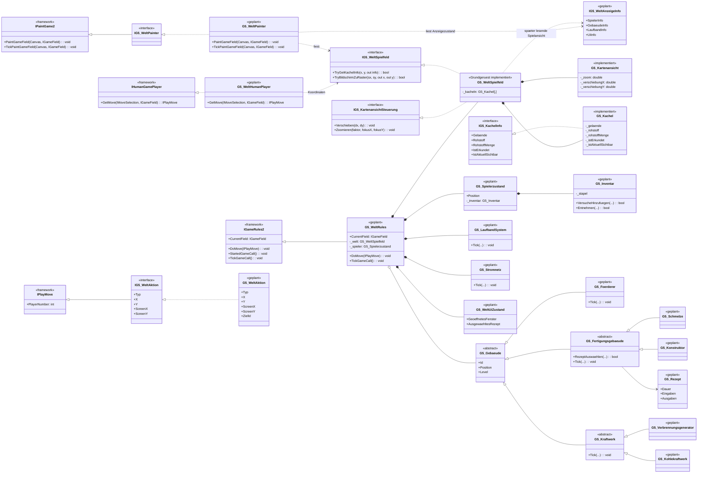

# Gesamtkonzept: 2D-Fabrikspiel

## 1. Spielidee und Ziel

Das Spiel ist ein kleines, zeitbasiertes Fabrik-Aufbauspiel in einer zweidimensionalen Kachelwelt. Der Spieler erkundet eine Karte, sammelt Rohstoffe, stellt Gegenstände her und baut Förderer, Produktionsgebäude, Laufbänder und Stromerzeuger. Gebäude produzieren selbstständig, solange sie die nötigen Eingaben und Energie haben.

Der erste Spielmodus ist **Cozy**: kein Zeitlimit und kein Gegner. Missionen oder ein kompetitiver Modus sind spätere Erweiterungen. Das Spiel soll in kleinen, nachvollziehbaren Schritten wachsen; für die erste Version werden feste Karten- und Rezeptdaten verwendet.

Das detaillierte Spielfeldkonzept steht in [Tim_Eichert_Spielfeldkonzept.md](./Tim_Eichert_Spielfeldkonzept.md), das Spielfeldklassendiagramm in [Tim_Eichert_Spielfeld_UML.md](./Tim_Eichert_Spielfeld_UML.md).

## Aktueller Prototyp

Der erste einfache Spielablauf ist in den Spielklassen umgesetzt: feste Karte mit zwei Eisenvorkommen, ein vorhandenes HUB/Lager, Förderer- und Schmelzenplatzierung per Klick und automatische Erz-/Barrenproduktion. `F` wählt einen Förderer, `S` eine Schmelze, `Esc` hebt die Auswahl auf; danach wird auf eine passende freie Fläche geklickt. Das HUB übernimmt im Prototyp automatisch den Itemtransport. Gebäude sind kostenlos; Laufbänder, Stromversorgung, Handabbau und Handcrafting sind noch nicht Teil dieser Version. Da `MainWindow.xaml.cs` unverändert bleiben muss, ist der Prototyp noch nicht über die Framework-Auswahllisten startbar.

Die Maschinen und ihre Fabriksimulation werden aus Chris' `Christian_Frey_FabrikGebaeude.cs` wiederverwendet. Der Spielcode erzeugt die feste Karte, prüft die Platzierung, taktet die Simulation und transferiert Gegenstände zum/vom HUB.

## 2. Architekturprinzipien

- **OOPGames-Rollen bleiben getrennt:** Rules verwalten Zustand und Regeln, Player übersetzt Eingaben in Aktionen, Painter zeichnet. Keine dieser Rollen soll die Implementierung einer anderen Rolle direkt voraussetzen.
- **Ein zentraler Zustand:** `G5_FabrikRules` besitzt im Prototyp das Spielfeld und koordiniert Fabriksimulation sowie Aktionen. `CurrentField` veröffentlicht das Spielfeld nur über `IGameField`.
- **Renderzustand erreichbar machen:** OOPGames übergibt dem Painter nur `IGameField`. Daher muss das Feld darzustellende Zustände (Gebäude, Spieler, Laufbänder und UI-Anzeige) über kleine, nur lesende `IG5_...Info`-Verträge erreichbar machen. Die Rules bleiben die einzige Stelle, die diese Zustände verändert.
- **Eingaben sind Befehle:** Der Player entscheidet nicht, ob eine Aktion zulässig ist. Er erzeugt eine Aktion; die Rules prüfen und führen sie aus.
- **Simulation ist unabhängig von Darstellung:** Die Regeln verändern keine Canvas-Elemente. Der Painter liest Spielzustand und zeichnet ihn.
- **Daten und Ebenen trennen:** Gelände/Rohstoffe, Gebäude, Laufbänder und Stromnetz werden nicht in einer gemeinsamen Kachelvariable vermischt.
- **Schnittstellen klein halten:** Öffentliche Verträge geben nur die Informationen oder Befehle frei, die eine andere Rolle benötigt. Arrays, interne Collections und Setter bleiben verborgen.

## 3. Einbindung in OOPGames

| OOPGames-Vertrag | Geplante Gruppe-5-Komponente | Zweck |
|---|---|---|
| `IGameRules2` (`IGameRules`) | `G5_FabrikRules` | Spielfeld besitzen, Aktionen prüfen und die zeitbasierte Simulation aktualisieren |
| `IGameField` | `G5_FabrikSpielfeld : IG5_FabrikSpielInfo` | Welt- und Fabrikzustand read-only bereitstellen sowie Painter-Kompatibilität prüfen |
| `IPaintGame2` (`IPaintGame`) | `G5_FabrikPainter : IG5_FabrikPainter` | Karte und Produktionszustand nach Aktionen und beim Framework-Tick darstellen |
| `IHumanGamePlayer` | `G5_FabrikHumanPlayer` | `F`, `S`, `Esc` und Kartenklicks in Fabrikaktionen übersetzen |
| `IPlayMove` | `G5_FabrikAktion : IG5_FabrikAktion` | Unveränderliche Daten einer Bauwerkzeug- oder Platzierungsaktion übergeben |

Rules, Painter und Player benötigen jeweils eine eindeutige `Name`-Property. Der Player muss außerdem `SetPlayerNumber`, `PlayerNumber`, `CanBeRuledBy` und `Clone` korrekt implementieren; seine Spielwelt darf nicht in der geklonten Controller-Instanz gespeichert werden.

`G5_FabrikRules.TickGameCall()` wird vom Framework zusammen mit dem Darstellungstick aufgerufen (derzeit etwa alle 40 ms). Der Tick dient der zeitbasierten Simulation; er darf keine blockierenden Wartezeiten enthalten. `StartedGameCall()` kann eine Spielsitzung initialisieren. `ClearField()` setzt Welt und Fabriksimulation zurück.

Das Framework erwartet bei `CheckIfPLayerWon()` laut Vertrag `-1`, wenn niemand gewonnen hat. Für den Cozy-Modus gibt es normalerweise keinen Sieger; Missionsziele können später einen Abschlusszustand ergänzen. `MovesPossible` ist solange wahr, wie die Sitzung Eingaben annimmt.

### Wichtige Rahmenbedingung: Spielerwechsel im MainWindow

Das vorhandene `MainWindow` wechselt nach jeder gültigen Aktion zwischen Spieler 1 und Spieler 2. Die drei Fabrikrollen sind im bestehenden Registrierungsblock eingetragen. Für den Workaround wird derselbe `G5_FabrikHumanPlayer` in beiden Spielerslots gewählt; beide Controller verändern denselben Fabrikzustand. Die Statuszeile zeigt dabei weiterhin wechselnde Spielernummern.

Ein Computer-Spieler ist für die erste Version nicht vorgesehen: `MainWindow` führt Computerzüge synchron in einer Schleife aus. Ein stets gültige Aktionen liefernder Computer könnte damit eine Echtzeitsimulation blockieren.

## 4. Vorgeschlagene Klassen und Zuständigkeiten

Dateien folgen dem Projektschema `Tim_Eichert_<Inhalt>.cs`; eigene Klassen und Interfaces tragen das Präfix `G5_` beziehungsweise `IG5_`. Die Tabelle benennt fachliche Bausteine, keine Verpflichtung, für jede Zeile eine eigene Datei anzulegen.

### Spielsteuerung und Darstellung

| Klasse / Interface | Aufgabe | Stand / Zuständigkeit |
|---|---|---|
| `G5_FabrikRules` | Implementiert `IGameRules2`; validiert Werkzeugwahl und Platzierung, koordiniert Fabriksimulation und Reset. | MVP implementiert – Erweiterung Maxi |
| `G5_FabrikAktion` / `IG5_FabrikAktion` | Read-only Befehl für Werkzeugwahl und Gebäudeplatzierung; implementiert `IPlayMove`. | MVP implementiert – Erweiterung Maxi |
| `G5_FabrikHumanPlayer` | Verarbeitet `F`, `S`, `Esc` und Kartenklicks; liefert eine Fabrikaktion. | MVP implementiert |
| `G5_FabrikPainter` / `IG5_FabrikPainter` | Zeichnet Karte, Rohstoffe, Gebäude, HUB-Bestand und Status; keine Spielzustandsänderungen. | MVP implementiert |
| `IG5_FabrikSpielInfo` | Schmale read-only Sicht auf Gebäude, HUB-Mengen, Bauwerkzeug und Statusanzeige. | MVP implementiert |
| `G5_FabrikSpielfeld` | Aggregiert Spielfeld und Anzeige der Fabriksimulation; übergibt keine veränderbaren Gebäudeobjekte. | MVP implementiert |
| `G5_WeltSpielfeld` / `G5_Kachel` | Speichert Raster, Gelände, Rohstoffe und Erkundung. | Grundgerüst implementiert – Tim |
| `G5_Kartenansicht` | Koordinatenumrechnung, Zoom und Verschiebung; Steuerung über das getrennte `IG5_KartenansichtSteuerung`. | Grundgerüst implementiert – Tim |

### Welt- und Fabrikzustand

| Klasse | Aufgabe | Vorschlag |
|---|---|---|
| `G5_Spielerzustand` | Position und Inventar des menschlichen Spielers; gehört zum Spielzustand, nicht zur Player-Controller-Instanz. | Eine Instanz im Cozy-MVP |
| `G5_Inventar` / `G5_Gegenstandsstapel` | Begrenzter Platz, Mengen und kontrolliertes Hinzufügen/Entnehmen; fehlgeschlagene Aufnahme verändert den Bestand nicht. | Kapazität zunächst in Slots oder Einheiten festlegen |
| `G5_Gegenstandstyp` (Enum) | Abbaubare Rohstoffe und verarbeitete Produkte wie Erz, Barren, Platten und Stangen. | Rohstoffvorkommen im Feld bleiben davon getrennt |
| `G5_Gebaeude` | Abstrakte Basis mit ID, Position, Level und Zustand. Kein Canvas-Code. | Chris |
| `G5_Miner` | Entnimmt in Zeitintervallen Eisenerz aus dem Vorkommen unter sich und legt es ins Ausgabelager. | Vorhanden bei Chris; im MVP integriert |
| `G5_Fertigungsgebaeude` | Gemeinsame Produktionslogik mit Rezept, Eingangs-/Ausgangslager und Fortschritt. | Chris |
| `G5_Smelter`, `G5_Constructor` | Spezialisierte Produktionsgebäude mit jeweils zulässigen Rezepten. | Vorhanden bei Chris; Schmelze im MVP integriert |
| `G5_Storage` | Begrenztes HUB/Lager und Transferpunkt für Erz und Barren. | Vorhanden bei Chris; im MVP integriert |
| `G5_FactorySimulation` | Aktualisiert Maschinenzustände in diskreten Ticks und verwaltet hinzugefügte Gebäude. | Vorhanden bei Chris; im MVP integriert |
| `G5_Kraftwerk` | Gemeinsame Erzeugerlogik; konkrete Generatoren verbrauchen Brennstoff und erzeugen Leistung. | Chris / Maxi |
| `G5_Verbrennungsgenerator`, `G5_Kohlekraftwerk` | Konkrete Kraftwerkvarianten mit abgestimmtem Brennstoff- und Leistungsprofil. | Chris / Maxi |
| `G5_Rezept` | Unveränderliche Eingabe-/Ausgabemengen, Produktionsdauer und zulässiger Maschinentyp. | Chris |
| `G5_LaufbandSegment` / `G5_LaufbandSystem` | Getrennte Belt-Belegung, Richtung/Verbindung und Transport von Gegenständen über Zeit. | Chris |
| `G5_Stromnetz` | Ermittelt verbundene Strombereiche und gleicht Erzeugung/Verbrauch ab. Wird als Overlay dargestellt. | Chris / Maxi |
| `G5_Sichtsystem` | Aktualisiert `IstAktuellSichtbar` und dauerhaftes `IstErkundet` um den Spieler herum. | Maxi |
| `G5_Missionssystem` | Prüft optionale Ziele, Zeitlimits und Fehlschlagzustände. Für den Cozy-MVP nicht erforderlich. | Maxi |
| `G5_KartenGenerator` | Erzeugt eine Karte aus Konfiguration oder Seed. Für den Anfang kann eine feste Testkarte genügen. | Tim / Maxi |

**Abgrenzung:** `G5_FabrikRules` koordiniert im Prototyp die Systeme, enthält aber nicht selbst Rezeptlisten, Lagerdetails oder Produktionslogik. In der ersten Version werden Maschinen und Ticks durch Chris' Simulation verwaltet.

## 5. Zentrale Spielabläufe

### Eingabe und Aktion

1. Das Framework liefert dem `G5_FabrikHumanPlayer` eine Maus- oder Tastaturauswahl und das Feld als `IGameField`.
2. Der Player wandelt die Auswahl in eine typisierte `G5_FabrikAktion` um. Bei Kartenklicks kann er über `IG5_WeltSpielfeld.TryBildschirmZuRaster(...)` die Rasterkoordinate ergänzen.
3. Der Player gibt die Aktion zurück oder `null`, wenn die Eingabe keine Aktion ergibt.
4. `G5_FabrikRules.DoMove(...)` prüft die Aktion und führt gültige Werkzeugwahl oder Gebäudeplatzierung aus.
5. Nur bei gültiger Aktion ändert sich der Spielzustand; der Painter zeichnet ihn anschließend neu.

### Zeitbasierte Fabrik

`TickGameCall()` aktualisiert die Simulation in einer festen und dokumentierten Reihenfolge:

1. Stromerzeugung und verfügbare Leistung ermitteln.
2. Förderer und Produktionsgebäude fortschreiten lassen, sofern Voraussetzungen erfüllt sind.
3. Laufbandgegenstände bewegen und Ein-/Ausgänge übertragen.
4. Spielerposition, Sichtbarkeit und zeitabhängige UI-/Missionszustände aktualisieren.

Für den MVP soll ein einfacher fester Tick oder verstrichene Zeit mit begrenztem Delta verwendet werden. Produktionslogik darf nicht davon abhängen, wie lange das Zeichnen dauert. Gebäude mit fehlenden Eingaben, vollem Ausgabelager oder ohne Strom pausieren nachvollziehbar.

### Darstellung und Gebäudefenster

Der Painter zeichnet Terrain und Fog-of-War zuerst, danach Rohstoffe, Laufbänder/Gegenstände, Gebäude und Spieler; HUD und Auswahlfenster werden zuletzt darübergelegt. Ein Rezeptfenster kann zunächst direkt im Canvas gerendert werden. Die Rules besitzen den UI-Zustand und lösen Klicks auf ein geöffnetes Fenster vor Weltaktionen auf.

Das bestehende Framework liefert in `IMoveSelection` Klicks und Tastendrücke, aber keine fertigen UI-Controls. Deshalb muss die erste Oberfläche mit Canvas-Zeichnung und den verfügbaren Eingaben auskommen. Zoom/Pan kann über die bereits angelegte Kartenansichtssteuerung angebunden werden; konkrete Maus-Rad-/Drag-Bedienung ist vorab mit dem Framework-Verhalten zu prüfen.

**Noch zu vereinbarender Datenvertrag:** Das aktuelle `IG5_WeltSpielfeld` gibt Kacheln und Koordinatenumrechnung frei, aber noch keine Gebäude-, Spieler-, Laufband-, Energie- oder UI-Anzeigedaten. Da Player und Painter vom Framework nur `IGameField` erhalten, müssen diese später über schmale read-only Interfaces am Spielfeld erreichbar sein. Painter/Player dürfen dafür nicht auf konkrete Rules- oder Gebäudeimplementierungen zugreifen.

## 6. Datenebenen und Spielregeln

- **Kachelwelt:** endliches Raster; `x` ist Spalte, `y` Zeile. Begehbarkeit und Ressourcenvorkommen sind getrennte Eigenschaften.
- **Ressourcen:** Vorkommen aus `Anforderungen.md` (Holz, Eisen, Kupfer, Kohle, Kalkstein, Quarz, Schwefel, Uran, Wasser, Gas, Öl). Ob jedes Vorkommen im MVP benutzt wird, ist eine Umfangsentscheidung.
- **Inventar und Lager:** begrenzte Kapazität; Gegenstände können nicht verloren gehen, wenn eine Aufnahme scheitert.
- **Gebäude:** Platzierung, Abbau, Verschieben und Upgrades laufen über validierte Rules-Aktionen. Gebäudefläche und Kollision werden in einem separaten Belegungslayer geprüft.
- **Laufbänder:** eigene Belegung, damit ein Band nicht Gelände, Ressource oder Gebäudezustand überschreibt. Für die erste Version einen Gegenstand pro Segment und eine einfache Richtung festlegen.
- **Energie:** Stromverbindungen überdecken die Karte als separates Netz/Overlay. Maschinen ohne ausreichende Leistung produzieren nicht.
- **Sicht:** `IstErkundet` bleibt dauerhaft wahr, sobald ein Feld erkundet wurde; `IstAktuellSichtbar` wird pro Simulation aktualisiert.
- **Rezepte:** Schmelze wandelt Erz in Barren; Konstruktor wandelt Barren in Platten oder Stangen. Rezeptdaten sollen nicht im Painter oder Player liegen.

## 7. Großer Überblick als UML

Das folgende Diagramm skizziert die geplante Vollversion; die konkreten Klassenbeziehungen des aktuellen Prototyps sind in [Tim_Eichert_Spielfeld_UML.md](./Tim_Eichert_Spielfeld_UML.md) dokumentiert. `<<geplant>>` kennzeichnet noch zu implementierende Spielteile.

## 8. Umsetzungsstufen

### Stufe 1 – spielbarer Kern

- Feste Testkarte mit Eisenvorkommen und HUB/Lager.
- Bauwerkzeug per Taste wählen (`F` Förderer, `S` Schmelze, `Esc` abbrechen), Gebäude per Klick platzieren.
- Automatische Erzförderung, Versorgung der Schmelze aus dem HUB und Rücklagerung der Eisenbarren.
- HUD mit Bauwerkzeug, HUB-Mengen und Maschinenstatus. Gebäude sind im MVP kostenlos; Strom und Laufbänder sind deaktiviert.

### Stufe 2 – Fabrikproduktion

- Weitere Rezepte und Gegenstandstypen, Konstruktor und Handcrafting.
- Gebäude anklicken, Auswahlfenster und Rezeptwahl.
- Kosten, Upgrade und Verschieben, nachdem ihre Regeln abgestimmt sind.

### Stufe 3 – Transport und Energie

- Laufbandsegmente verbinden und Gegenstände sichtbar transportieren.
- Generatoren, Stromnetz und klare Regeln bei Energiemangel.
- Upgrades und Gebäude verschieben, falls Zeit und Projektumfang es erlauben.

### Stufe 4 – Ausbau

- Mehr Rohstoffarten, Kartengenerierung, Fog-of-War, Speicherstand und Missionsmodus.
- Balancing, zusätzliche Rezepte, größere Gebäude-Footprints und weitere UI-Verbesserungen.

## 9. Zuständigkeiten und notwendige Teamentscheidungen

- **Tim (Spielfeld):** Raster, Kacheln, Kartenansicht, Belegungs-/Leseschnittstellen und später Karteninitialisierung.
- **Maxi (Game-Logik/Interaktion):** Rules, Aktionen, Spieler, Simulationstakt, Sichtsystem und UI-Abläufe.
- **Chris (Gebäude):** Gebäudebasisklassen, Maschinen, Rezepte und Gebäude-/Lagerverhalten.
- **Gemeinsam:** Laufbandvertrag, Gebäude-Footprints, Stromnetz, Ressourcen-/Gegenstandsdaten, Integrations- und Spielmodusentscheidung.

Vor der Vollimplementierung festlegen:

1. Ist das Spiel offiziell Einzelspieler, kooperativ oder kompetitiv? Für den aktuellen Prototyp wird der Zwei-Spieler-Wechsel durch denselben Human-Player in beiden Slots überbrückt.
2. Welche Kartengröße, Spawnposition und Startausrüstung hat die Demo?
3. Sind Gebäude und Laufbänder im MVP jeweils ein Feld groß? Wie funktionieren Kollisionen und Verschieben?
4. Welche konkreten Rohstoffe, Rezepte und Kapazitätsgrenzen gehören in die erste lauffähige Version?
5. Wie werden Stromreichweite, Stromverbrauch und Überlast behandelt?
6. Wie schnell laufen Spielzeit und Produktion, und braucht der MVP Pause/Spielgeschwindigkeit?
7. Welche Eingabetasten und Canvas-HUD-Elemente sind mit dem vorhandenen Framework zuverlässig möglich?

## 10. Tests und Abnahmekriterien

- Spielfeldzugriff an Rand, außerhalb der Karte und bei ungültigen Dimensionen.
- Ungültige Bewegungs-, Bau-, Abbau- und Rezeptaktionen verändern keinen Zustand.
- Inventarüberlauf und fehlende Eingaben verhindern Verlust oder Erzeugung von Gegenständen.
- Produktionsgebäude produzieren nur mit Rezept, Eingaben, Platz im Ausgabelager und ausreichender Energie.
- Laufbandgegenstände bewegen sich nicht doppelt und können nicht in belegte Ausgänge geschoben werden.
- Kartenumrechnung bleibt bei Zoom/Verschiebung konsistent; Fog-of-War unterscheidet aktuell sichtbar und dauerhaft erkundet.
- Integration: `CanBePaintedBy` und Player-/Rules-Kompatibilität prüfen; den Start mit dem Fabrik-Painter, den Fabrik-Rules und demselben Fabrik-Human-Player in beiden Slots testen.

## 11. Bekannte Grenzen

Dieses Konzept ist ein Vorschlag auf Basis von `Anforderungen.md` und den sichtbaren Framework-Verträgen; es ersetzt keine Teamvereinbarung. Der bestehende Spielfeldkern und der Fabrik-MVP sind implementiert, viele Komponenten aus dem Gesamtkonzept sind ausdrücklich noch geplant. In `MainWindow.xaml.cs` wurden ausschließlich die drei Fabrikrollen im vorhandenen Registrierungsblock ergänzt.
