# UML-Klassendiagramm: Spielfeld des 2D-Fabrikspiels

Das Diagramm zeigt den implementierten Fabrikspiel-Prototyp und offene Erweiterungen. `G5_KachelAnsicht` entfällt: Die interne Kachel implementiert direkt ein nur lesendes Interface. Gebäude und Simulation werden aus Chris' Fabrikmodell wiederverwendet.

```mermaid
classDiagram
    direction LR

    class IGameField {
        <<interface>>
        +CanBePaintedBy(IPaintGame painter) bool
    }

    class IPaintGame {
        <<interface>>
        +PaintGameField(Canvas canvas, IGameField field) void
    }

    class IPaintGame2 {
        <<interface>>
        +TickPaintGameField(Canvas canvas, IGameField field) void
    }

    class IGameRules2 {
        <<interface>>
        +TickGameCall() void
    }

    class IGameRules {
        <<interface>>
        +CurrentField IGameField
        +MovesPossible bool
        +DoMove(IPlayMove move) void
        +ClearField() void
        +CheckIfPLayerWon() int
    }

    class IG5_WeltSpielfeld {
        <<interface>>
        +Breite: int
        +Hoehe: int
        +TryGetKachelInfo(x, y, out info): bool
        +TryBildschirmZuRaster(x, y, out rasterX, out rasterY): bool
        +TryRasterZuBildschirm(x, y, out position): bool
    }

    class IG5_KartenansichtSteuerung {
        <<interface>>
        +Verschieben(deltaX, deltaY): void
        +Zoomieren(faktor, fokusX, fokusY): void
    }

    class IG5_KachelInfo {
        <<interface>>
        +Gelaende: G5_Gelaendeart
        +Rohstoff: G5_Rohstofftyp
        +RohstoffMenge: int
        +IstErkundet: bool
        +IstAktuellSichtbar: bool
    }

    class IG5_WeltPainter {
        <<interface>>
        +PaintWeltField(Canvas, IG5_WeltSpielfeld): void
        +TickPaintWeltField(Canvas, IG5_WeltSpielfeld): void
    }

    class IG5_FabrikSpielInfo {
        <<interface>>
        +AktuellesWerkzeug: G5_Bauwerkzeug
        +Gebaeude: IReadOnlyList~IG5_GebaeudeInfo~
        +HubMenge(item): int
        +StatusMeldung: string
    }

    class IG5_GebaeudeInfo {
        <<interface>>
        +Typ: G5_FabrikGebaeudeTyp
        +Name: string
        +X: int
        +Y: int
        +Breite: int
        +Hoehe: int
        +Status: G5_BuildingStatus
    }

    class IG5_FabrikPainter {
        <<interface>>
    }

    class IG5_FabrikAktion {
        <<interface>>
        +Aktionstyp: G5_FabrikAktionstyp
        +Werkzeug: G5_Bauwerkzeug
        +X: int
        +Y: int
    }

    class G5_WeltSpielfeld {
        -_breite: int
        -_hoehe: int
        -_kacheln: G5_Kachel[,]
        -_kartenansicht: G5_Kartenansicht
        +G5_WeltSpielfeld(breite, hoehe)
        +IG5_WeltSpielfeld.Breite: int
        +IG5_WeltSpielfeld.Hoehe: int
        +IG5_WeltSpielfeld.TryGetKachelInfo(x, y, out info): bool
        +IG5_WeltSpielfeld.TryBildschirmZuRaster(x, y, out rasterX, out rasterY): bool
        +IG5_WeltSpielfeld.TryRasterZuBildschirm(x, y, out position): bool
        +IGameField.CanBePaintedBy(IPaintGame painter): bool
        +IG5_KartenansichtSteuerung.Verschieben(deltaX, deltaY): void
        +IG5_KartenansichtSteuerung.Zoomieren(faktor, fokusX, fokusY): void
        ~TryReduceRohstoff(x, y, menge): bool
        ~VerschiebeAnsicht(dx, dy): void
        ~AendereZoom(faktor, fokusX, fokusY): void
    }

    class G5_Kachel {
        <<internal>>
        -_gelaende: G5_Gelaendeart
        -_rohstoff: G5_Rohstofftyp
        -_rohstoffMenge: int
        -_istErkundet: bool
        -_istAktuellSichtbar: bool
    }

    class G5_FabrikHumanPlayer {
        +GetMove(IMoveSelection, IGameField): IPlayMove
    }

    class G5_FabrikSpielfeld {
        -_welt: G5_WeltSpielfeld
        -_simulation: G5_FactorySimulation
        -_hub: G5_Storage
        +IG5_FabrikSpielInfo.Gebaeude
        +IG5_FabrikSpielInfo.HubMenge(item): int
        +IGameField.CanBePaintedBy(IPaintGame): bool
    }

    class G5_FabrikAktion {
        -PlayerNumber: int
        -Aktionstyp: G5_FabrikAktionstyp
        -Werkzeug: G5_Bauwerkzeug
        -X: int
        -Y: int
    }

    class G5_Stromnetz {
        <<geplant>>
        -_verbindungen: Sammlung~Verbindung~
    }

    class G5_FabrikRules {
        -_feld: G5_FabrikSpielfeld
        -_vorkommen: Dictionary
        +CurrentField: IGameField
        +TickGameCall(): void
        +DoMove(IPlayMove): void
        +ClearField(): void
        +CheckIfPLayerWon(): int
    }

    class G5_FabrikPainter {
        +PaintGameField(Canvas canvas, IGameField field): void
        +TickPaintGameField(Canvas, IGameField): void
    }

    class G5_FactorySimulation {
        +Buildings: IReadOnlyList~G5_Building~
        +AddBuilding(G5_Building): void
        +Tick(): void
    }

    class G5_Miner
    class G5_Smelter
    class G5_Storage

    class IHumanGamePlayer {
        <<framework interface>>
        +GetMove(IMoveSelection, IGameField): IPlayMove
    }

    class G5_Kartenansicht {
        -_zoom: double
        -_verschiebungX: double
        -_verschiebungY: double
        ~TryBildschirmZuRaster(x, y): bool
        ~TryRasterZuBildschirm(x, y, out position): bool
    }

    class G5_Gelaendeart {
        <<enumeration>>
        Begehbar
        Hindernis
    }

    class G5_Rohstofftyp {
        <<enumeration>>
        Holz
        Eisen
        Kupfer
        Kohle
        Kalkstein
        Quarz
        Schwefel
        Uran
        Wasser
        Gas
        Oel
        Keiner
    }

    IGameRules <|-- IGameRules2
    IGameRules2 <|.. G5_FabrikRules
    IPaintGame <|-- IPaintGame2
    IGameField <|-- IG5_WeltSpielfeld
    IG5_WeltSpielfeld <|.. G5_WeltSpielfeld
    IG5_KartenansichtSteuerung <|.. G5_WeltSpielfeld
    IG5_KachelInfo <|.. G5_Kachel
    IPaintGame2 <|-- IG5_WeltPainter
    IG5_WeltPainter <|-- IG5_FabrikPainter
    IG5_FabrikPainter <|.. G5_FabrikPainter
    IG5_WeltSpielfeld <|-- IG5_FabrikSpielInfo
    IG5_FabrikSpielInfo <|.. G5_FabrikSpielfeld
    IG5_FabrikAktion <|.. G5_FabrikAktion
    IPlayMove <|-- IG5_FabrikAktion
    IHumanGamePlayer <|.. G5_FabrikHumanPlayer
    G5_WeltSpielfeld "1" *-- "1..*" G5_Kachel : enthält
    G5_WeltSpielfeld "1" *-- "1" G5_Kartenansicht : gemeinsame Ansichtsberechnung
    G5_WeltSpielfeld ..> IG5_KachelInfo : gibt lesend zurück
    G5_FabrikRules --> G5_FabrikSpielfeld : verwaltet
    G5_FabrikRules ..> G5_FabrikAktion : verarbeitet
    G5_FabrikSpielfeld *-- G5_WeltSpielfeld : Kartenwelt
    G5_FabrikSpielfeld *-- G5_FactorySimulation : Simulation
    IG5_KartenansichtSteuerung <|.. G5_FabrikSpielfeld
    G5_FactorySimulation o-- G5_Miner
    G5_FactorySimulation o-- G5_Smelter
    G5_FactorySimulation o-- G5_Storage
    G5_FabrikPainter ..> IG5_FabrikSpielInfo : liest Anzeige
    G5_FabrikPainter ..> IG5_WeltSpielfeld : liest Kacheln und Koordinaten
    G5_FabrikHumanPlayer ..> IG5_FabrikSpielInfo : liest Bauwerkzeug
    G5_FabrikHumanPlayer ..> IG5_WeltSpielfeld : rechnet Klick um
    G5_FabrikHumanPlayer ..> G5_FabrikAktion : erzeugt
    G5_FabrikSpielfeld ..> IG5_GebaeudeInfo : gibt read-only zurück
    G5_Kachel ..> G5_Gelaendeart : speichert
    G5_Kachel ..> G5_Rohstofftyp : speichert
```

## Hinweise zur Umsetzung

- Implementiert: `G5_WeltSpielfeld`, `G5_Kachel`, `G5_Kartenansicht`, `IG5_WeltSpielfeld`, `IG5_KartenansichtSteuerung`, `IG5_KachelInfo`, `G5_FabrikRules`, `G5_FabrikSpielfeld`, `G5_FabrikHumanPlayer`, `G5_FabrikPainter` und die Fabrik-Info-/Aktion-Interfaces.
- Offen: Laufbänder, Stromnetz, Sicht-Radius, Handabbau/-crafting und Ausbau der Karte. Die Fabrikrollen sind im vorhandenen Registrierungsblock von `MainWindow.xaml.cs` eingetragen.
- Die Implementierung nutzt aktuell 32 WPF-Layout-Einheiten pro Kachel und einen Zoomfaktor von 0,25 bis 4. Das Begrenzen der Ansicht am Canvas-Rand erfordert noch die sichtbare Canvas-Größe und die gewünschte Bedienung.
- `IG5_WeltSpielfeld` zeigt nur Breite, Höhe, lesenden Kachelzugriff sowie Bildschirm-/Rasterumrechnung.
- `TryRasterZuBildschirm` ist die entsprechende lesende Umrechnung für den Painter. `IG5_KartenansichtSteuerung` ist ein separates, schmales Befehlsinterface für Zoom und Verschiebung; es erweitert nicht den lesenden Spielfeldvertrag. Die konkrete Eingabeverdrahtung fehlt noch.
- `G5_Kachel` ist intern und implementiert `IG5_KachelInfo`. Der Painter erhält nur das Interface und keine Arrays oder Setter; ein zusätzlicher Snapshot-Typ wäre unnötig.
- Gelände/Hindernis, Rohstoffvorkommen, Gebäude, Laufbänder und Stromnetz sind getrennte Ebenen. Das Stromnetz wird als Overlay modelliert und überschreibt keine Geländedaten.
- Der Rohstoff-Enum enthält die Typen aus `Anforderungen.md`; die erste Karte muss nicht alle Typen direkt verwenden.
- `IstErkundet` bleibt dauerhaft erhalten, `IstAktuellSichtbar` wird von den Rules anhand des Sicht-Radius aktualisiert.
- `CanBePaintedBy` wird am Feld aufgerufen und prüft im Fabrikprototyp auf `IG5_FabrikPainter`. Die Richtung bedeutet: „Dieses Feld kann von diesem Painter gezeichnet werden.“
- Das Framework reicht dem Spieler in `GetMove` nur `IMoveSelection` und `IGameField` weiter. Deshalb liest der Spieler die gemeinsame Umrechnung über `IG5_WeltSpielfeld`; er bekommt nicht die Kartenansicht selbst.
- Gebäude werden in der wiederverwendeten `G5_FactorySimulation` verwaltet und dem Painter nur über `IG5_GebaeudeInfo` gezeigt. Laufbandbelegung ist noch nicht implementiert.
- In `MainWindow.xaml.cs` wurden ausschließlich Fabrik-Painter, Fabrik-Rules und Fabrik-Human-Player im bestehenden Registrierungsblock ergänzt.
- `~` bezeichnet im Diagramm interne Mitglieder, die nur innerhalb der Assembly verfügbar sind. Die Interface-Mitglieder sind als explizite Implementierungen dargestellt und werden über das jeweilige Interface aufgerufen.
- Das Raster ist im Diagramm als Sammlung von Kacheln dargestellt. Getrennte Gebäude- und Laufbandbelegungen verhindern, dass diese Ebenen oder Gelände/Rohstoffe einander überschreiben.
- `IGameRules2.TickGameCall()` ist optional und nur nötig, wenn die zeitbasierte Simulation den Tick-Aufruf des Frameworks nutzt.
